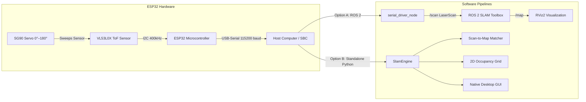

# 2D LiDAR SLAM with VL53L1X / VL53L0X & ESP32

A complete, production-ready Simultaneous Localization and Mapping (SLAM) system using an **ESP32**, an **SG90/MG90S micro servo**, and an ST **VL53L1X (up to 4m)** or **VL53L0X (up to 2m)** Time-of-Flight (ToF) distance sensor.

Supports both **ROS 2 (`slam_toolbox` + RViz2)** and a **Native Standalone Python SLAM Studio** with an interactive 2D occupancy grid GUI and built-in virtual room simulator.

---

## 📐 System Architecture



---

## 🛠️ Hardware Wiring & Connections

> [!CAUTION]
> **Power Notice**: An SG90 servo motor can draw up to 500mA–800mA stall current when changing sweep directions. **Never power the servo directly from the ESP32's 3.3V pin** (this causes brownouts and resets). Power the servo from an external 5V source or the ESP32 `VIN` pin (when connected to a 5V USB supply), and ensure a common ground (`GND`).

| Component | Pin | ESP32 Pin | Purpose |
|---|---|---|---|
| **VL53L0X** | VIN | `3.3V` (or `5V` if module has 3.3V regulator) | Sensor Power |
| **VL53L0X** | GND | `GND` | Common Ground |
| **VL53L0X** | SDA | `GPIO 21` | Hardware I2C Data |
| **VL53L0X** | SCL | `GPIO 22` | Hardware I2C Clock |
| **SG90 Servo** | Signal (Orange/Yellow) | `GPIO 18` | PWM Servo Control |
| **SG90 Servo** | VCC (Red) | `5V` / `VIN` (External 5V) | Servo Power |
| **SG90 Servo** | GND (Brown/Black) | `GND` | Common Ground |

---

## 🚀 Quick Start (Standalone SLAM Studio)

The standalone SLAM engine runs immediately on **macOS, Linux, and Windows** using Python 3 and NumPy, without requiring ROS 2 to be installed.

### 1. Run with Virtual Simulator (No hardware needed)
Test the complete SLAM pipeline, mapping, and teleoperation immediately:
```bash
python3 -m standalone_slam.main --sim
```
* **Teleop**: Use `W`, `A`, `S`, `D` or arrow keys to drive the virtual robot inside the simulated room.
* **Map Display**: Real-time log-odds occupancy grid, active laser rays, detected obstacle points, and robot trajectory.
* **Export**: Click **"💾 Save Map (ROS PGM / YAML)"** to export standard ROS-compatible map files.

### 2. Run with Physical ESP32 Hardware
Connect the ESP32 to your computer via USB:
```bash
# Auto-detects serial port
python3 -m standalone_slam.main

# Or specify your port explicitly:
python3 -m standalone_slam.main --port /dev/cu.usbserial-0001 --baud 115200
```

---

## ⚡ Flashing the ESP32 Firmware

### Option A: Arduino IDE
1. Open `firmware/esp32_vl53l0x_lidar/esp32_vl53l0x_lidar.ino`.
2. Install the following libraries via the Arduino Library Manager:
   - **VL53L0X** by *Pololu*
   - **ESP32Servo** by *Kevin Harrington*
3. Select your board (`ESP32 Dev Module`) and port, then click **Upload**.

### Option B: PlatformIO
```bash
cd firmware
pio run --target upload
```

### Serial Communication Protocol
The firmware outputs self-synchronizing ASCII packets over Serial:
```text
$SCAN,<direction>,<point_count>   # direction: 1 (0°->180°), -1 (180°->0°)
0,850                             # <angle_deg>,<distance_mm>
2,848
...
180,910
$END                              # End of frame
```

---

## 🤖 ROS 2 Workspace & SLAM Toolbox

The repository includes a complete ROS 2 package (`vl53l0x_lidar_slam`) configured for ROS 2 Humble / Iron / Rolling.

### 1. Build the ROS 2 Workspace
```bash
cd ros2_ws
colcon build --symlink-install
source install/setup.bash
```

### 2. Launch SLAM with Real Hardware
```bash
ros2 launch vl53l0x_lidar_slam slam_toolbox.launch.py port:=/dev/ttyUSB0
```

### 3. Launch SLAM in Simulation Mode (No hardware required)
```bash
ros2 launch vl53l0x_lidar_slam slam_toolbox.launch.py use_mock:=true
```
This automatically starts:
- The LiDAR driver (publishing `sensor_msgs/msg/LaserScan` to `/scan`)
- Static TF publisher (`base_link` -> `laser_frame`)
- `slam_toolbox` in asynchronous 2D mapping mode (tuned for VL53L0X 2.0m range)
- RViz2 with pre-configured displays for `/scan`, `/map`, and `/tf`.

---

## 📁 Repository Structure

```
SLAM/
├── firmware/
│   ├── esp32_vl53l0x_lidar/
│   │   └── esp32_vl53l0x_lidar.ino       # ESP32 C++ firmware (continuous ranging & sweep)
│   ├── platformio.ini                    # PlatformIO configuration
│   └── wiring_diagram.md                 # Detailed pinout and power guide
│
├── ros2_ws/                              # ROS 2 workspace (ready for colcon build)
│   └── src/
│       └── vl53l0x_lidar_slam/
│           ├── package.xml
│           ├── setup.py
│           ├── launch/
│           │   ├── lidar_driver.launch.py   # Serial driver & TF
│           │   └── slam_toolbox.launch.py   # Full SLAM + RViz2 launch
│           ├── config/
│           │   ├── slam_toolbox_params.yaml # Tuned SLAM parameters
│           │   └── vl53l0x_rviz.rviz        # Pre-configured RViz2 view
│           └── vl53l0x_lidar_slam/
│               ├── serial_driver_node.py    # Serial to ROS LaserScan publisher
│               └── mock_serial_node.py      # Synthetic LaserScan generator
│
├── standalone_slam/                      # Pure Python SLAM (Runs natively on macOS)
│   ├── main.py                           # CLI entry point (GUI or Headless)
│   ├── occupancy_grid.py                 # 2D Log-odds map + Bresenham ray-casting
│   ├── scan_matcher.py                   # Correlative Scan-to-Map matching
│   ├── serial_reader.py                  # Auto-discovering serial interface
│   ├── simulator.py                      # Virtual room & noisy ray-caster
│   └── gui.py                            # Interactive Tkinter 2D visualizer
│
└── tools/
    ├── serial_test.py                    # Serial verification & live throughput tool
    └── export_ros_map.py                 # Generates ROS PGM/YAML map files
```

---

## 🔬 SLAM Algorithm Details

1. **Log-Odds Occupancy Grid Update**:
   $$L(m_i) \leftarrow L(m_i) + l_{occ} - l_0 \quad \text{(obstacle hit endpoint)}$$
   $$L(m_i) \leftarrow L(m_i) + l_{free} - l_0 \quad \text{(traversed beam cells)}$$
   Probabilities are derived using $p(m_i) = 1 - \frac{1}{1 + e^{L(m_i)}}$.

2. **Bidirectional Sweep Normalization**:
   Because the servo sweeps back-and-forth ($0^\circ \to 180^\circ \to 0^\circ$), the reverse stroke is automatically inverted so that index 0 is always at the minimum angle ($-90^\circ$ relative to forward), ensuring compatibility with standard ROS 2 scan matchers.

3. **Map Export**:
   Exports to standard `.pgm` and `.yaml` formats recognized by ROS 2 Nav2 `nav2_map_server` and ROS 1 `map_server`.

